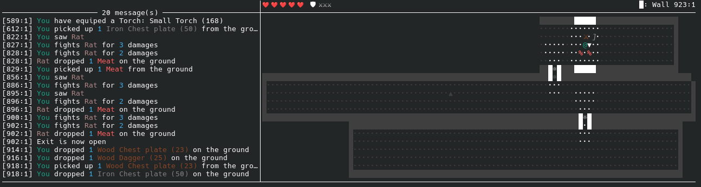

# DungeonGenerator

[](https://github.com/FaustVX/DungeonGenerator/releases/latest)
[](https://github.com/FaustVX/DungeonGenerator/actions/workflows/release.yml)



DungeonGenerator is a terminal-based dungeon crawler written in C# with .NET. It generates procedural dungeon layouts, places enemies and loot, and lets you explore a growing number of floors using keyboard controls in a classic roguelike style.

## Features

- Procedural dungeon generation using a BSP-based map generator
    - in the future, more generators will be introduced
- Randomized rooms, corridors, stairs, items, and enemy placement
- Turn-based movement and combat
- Fog-of-war and field-of-view lighting
- Inventory, equipment, and actionable tile interactions
- Torch and light management
- Material based items
- Seeded levels for reproducible runs
- Built with Spectre.Console for terminal rendering
- Mouse support

## Gameplay overview

The player starts in a dungeon with a small set of items and must explore the floor, avoid or fight mobs, collect loot, and navigate between levels via stairs. Each level is generated from a seed.

## Controls

- Arrow keys or number pad movement: move the player
- 5 / Space / Enter: activate the current tile or main action
- E: open the player menu for inventory, equipment, and stats
- Enter: inspect actions for the current tile or ground items
- Esc: quit the game

## Project structure

- `App/` — main game logic and terminal UI
- `App/Generator/` — procedural generation logic
- `App/Creature/` — player and enemy entities
- `App/Item/` — weapons, armor, consumables, and equipment behaviors
- `App/Tile/` — floor, wall, stairs, and torch tile definitions
- `SourceGenerator/` — Roslyn source generator used by the app
- `SourceGenerator.CodeFix/` — code-fix companion for the generator

## Requirements

- .NET 11 SDK

## Run the project

From the repository root:

```bash
dotnet run --project App/DungeonGenerator.App.csproj
```

Provide a seed as an optional argument for reproducible generation:

```bash
dotnet run --project App/DungeonGenerator.App.csproj -- 12345
```

## Build

```bash
dotnet build DungeonGenerator.slnx
```

## License

This project is licensed under the [MIT License](LICENSE).

## Notes

This project is designed as an interactive terminal game rather than a library. The default experience is a console interface and is best run in a terminal that supports ANSI escape sequences.
